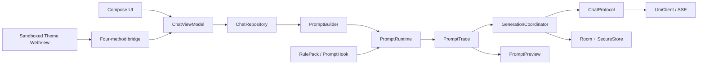

# SillyTavern 能力在 Mistbell Tavern Android 中的实现计划

状态：提案  
日期：2026-10-04  
目标项目：`mistbell-tavern-android`  

## 1. 目标与范围

本计划讨论如何把以下能力以 Android 原生方式落到 Mistbell Tavern：

- SillyTavern 角色卡、世界书、聊天记录和提示词语义的互操作。
- Prompt Template 文档中的变量、宏、阶段和提示词注入能力。
- Tavern Helper 所代表的事件、规则和扩展能力。
- 多 LLM 提供商、提示词追踪、流式生成和本地持久化。

这里的“实现”指根据格式、字段和协议建立自己的 Kotlin 代码。SillyTavern 的实现代码不进入本项目；项目已有许可证红线要求只参考格式和协议，不能引入 GPL/AGPL 代码，见 `docs/FOUNDATION.md`。

项目当前定位是本地优先的 Android 应用。第一阶段采用受限的 Kotlin 提示词运行时和声明式规则包。完整 EJS、任意 JavaScript、任意扩展安装和 Tavern Helper 的全量 API 作为后续可选项目，不能成为基础聊天链路的前置依赖。

## 2. 当前事实与约束

### 2.1 已有地基

- 工程是单模块 Kotlin Android 应用，采用 Compose、MVVM、Room、Coroutines、OkHttp/SSE 和手工 `AppContainer`。
- `PromptBuilder.buildPromptTrace()` 是当前唯一完整的提示词装配路径，已经返回带来源、激活原因、插入位置、裁剪原因和 provider 转换说明的 trace。
- `MacroEngine` 是无 Android 依赖的纯 Kotlin 宏引擎，已支持角色、用户、Persona、条件、随机、掷骰、时间和日期宏。
- 世界书运行时已经有递归激活、次关键词、概率、分组竞争、sticky、cooldown、delay、角色和深度插入能力。
- `CharacterEntity.data_json` 可以保存 CCv2/CCv3 的扩展字段；已有 PNG 埋卡、角色卡、世界书和 Tavern JSONL 导入导出代码。
- `ChatProtocol` 与 `LlmClient` 已经统一 OpenAI 兼容、Anthropic、Gemini、SSE、重试、取消和 thinking 响应。
- Room 数据库当前为 25 版，已有角色、会话、消息、世界书、记忆、主题、API 配置和自定义提示词实体。
- 导航中已经存在 Prompt 管理、世界书详情、提示词预览、聊天设置和主题管理入口。

### 2.2 需要遵守的产品边界

项目自己的设置规划明确将 STscript、任意脚本、宏插件系统和桌面端深度 Context Template 编辑列为暂不实现的内容。移动端扩展性采用主题包和规则包。

交互主题包可以使用 WebView，但必须遵守现有四方法桥协议：`onState`、`onChat`、`sendMessage`、`setDraft`。页面不能访问 API Key、Room、文件系统或 Android 原生接口，消息流仍由原生 Compose 渲染。

当前工作树已有未提交修改。实施时必须保留这些改动，禁止通过 reset、checkout、全仓格式化或覆盖式复制来清理工作区。

### 2.3 仍然未知的事项

- 目标是数据格式兼容、提示词语义兼容，还是必须兼容现有 EJS 脚本生态。
- 是否需要让规则包访问网络、生成图片、音频或其他外部服务。
- 世界书导入界面、Tavern JSONL 分支和附件字段的完整需求。
- 目标 Android 设备的内存、包体积和离线执行预算。

在这些问题明确前，计划按“数据与提示词语义优先、脚本兼容可选”的路径推进。

## 3. 目标架构



核心关系如下：

1. `PromptBuilder` 负责读取当前角色、会话、世界书、记忆和历史。
2. `PromptRuntime` 负责阶段、变量、宏、规则和注入。
3. `PromptTrace` 是预览、诊断和实际发送共用的唯一产物。
4. `GenerationCoordinator` 负责把 trace 交给 provider 适配器，处理流式事件和消息落库。
5. 主题 WebView 只通过受限桥接访问状态，不参与提示词构建和消息持久化。

## 4. 第一阶段：建立 Prompt Runtime

### 4.1 领域模型

建议新增 `app/src/main/java/com/mistbell/tavern/android/data/prompt/` 下的以下类型：

```kotlin
enum class PromptStage {
    PREPARE,
    GENERATE,
    MESSAGE,
    RENDER,
    RENDER_PERMANENT,
    POST_GENERATION,
}

data class PromptBlock(
    val id: String,
    val role: String,
    val content: String,
    val slot: PromptSlot,
    val priority: Int,
    val source: String,
    val stage: PromptStage,
)

data class PromptRunContext(
    val sessionId: String,
    val messageId: String?,
    val stage: PromptStage,
    val dryRun: Boolean,
)
```

`PromptBlock` 可以逐步映射到现有的 `PromptBuilder.Segment`，避免同时维护两套 trace 模型。现有的来源、激活原因、插入位置、裁剪原因和 provider 转换字段应继续保留。

### 4.2 接入已有自定义提示词

`CustomPromptEntity` 已经描述了提示词名称、正文、类型、位置、启用状态、优先级和标签，但当前管理界面生成的最终字符串没有进入聊天发送链。

实施步骤：

1. 新建 `PromptBlockResolver`，从 `CustomPromptDao` 读取启用的提示词。
2. 把 `SYSTEM_START`、`SYSTEM_END`、`USER_PREFIX`、`USER_SUFFIX` 和 `ASSISTANT_PREFIX` 映射到明确的 `PromptSlot`。
3. 在 `PromptBuilder.buildPromptTrace()` 中插入 block。
4. 删除或停用 `CustomPromptViewModel.buildFinalPrompt()` 中独立拼接的发送逻辑。
5. 完成 Prompt 管理页的拖拽排序和保存。
6. 让 Prompt Preview 和真实请求都使用同一个 trace。

验收要求：改变一个自定义提示词后，预览中显示的段落、发送前日志中的段落和实际 provider 请求的段落顺序一致。

### 4.3 宏引擎扩展

先扩展现有 `MacroEngine`，保持 Kotlin 纯函数和确定性测试：

- 增加 `else`、变量读取、简单 JSON 路径和显式转义。
- 支持注入随机数、时钟和宏上下文，测试时禁止依赖系统时间和默认随机源。
- 对未知宏保持原文，并在 `PromptTrace` 中记录 warning。
- 对嵌套深度、输出长度和重复展开次数设置限制。
- 不在模板字段之间进行隐式二次渲染。

第一阶段不执行任意 `<% JavaScript %>`。需要完整 EJS 时，另行启动沙箱项目。

## 5. 第二阶段：变量与执行阶段

### 5.1 变量持久化

建议新增 `prompt_variables` 表，而不是继续扩展已经较复杂的 `SessionEntity`：

```text
scope       global | local | message
owner_id
session_id
message_id
key
json_value
updated_at
```

运行时再提供两个非持久化作用域：

- `cache`：一次提示词构建期间的内存对象。
- `initial`：本次执行开始时的只读快照。

所有值使用 `JsonElement` 保存。变量修改必须经过 `PromptVariableStore`，不允许规则直接访问 Room DAO。

### 5.2 阶段与副作用

运行阶段按以下规则处理：

- `PREPARE`：读取数据、计算激活结果、构建内存变量副本。
- `GENERATE`：生成发送给模型的最终 trace。
- `MESSAGE`：解析新消息中的声明式更新。
- `RENDER`：只影响界面显示。
- `RENDER_PERMANENT`：用户明确允许时才修改消息正文。
- `POST_GENERATION`：保存变量、记忆和消息后处理结果。

预览和准备阶段必须使用 `dryRun=true`，禁止 Room 写入。类似 `saveVariables()` 的显式保存操作只能在允许持久化的阶段执行。

### 5.3 世界书注入

现有 `WorldInfoRuntime` 的激活逻辑继续保留。新增能力应将以下内容解析为独立的 `PromptBlock`：

- `@INJECT` 目标角色和绝对位置。
- `@@preload`、`@@only_preload`、`@@dont_preload` 等阶段装饰器。
- 正则注入和注入失败警告。
- `@D` 深度、role 和 provider 转换信息。

注入内容不能被合并成一条无来源的 system 字符串，否则 Prompt Preview 无法解释其来源，也无法保证 Anthropic/Gemini 等 provider 的角色转换正确。

世界书运行时状态应从全局静态 Map 逐步改为可注入的 session runtime。随机源、时钟和状态对象必须可以在单元测试中替换。

## 6. 第三阶段：互操作与生成协调

### 6.1 互操作范围

优先支持以下内容：

- CCv1、CCv2、CCv3 角色卡读取。
- PNG `chara`/`ccv3` 埋卡读取和导出。
- 角色卡内嵌 worldbook。
- 独立世界书 JSON。
- Tavern JSONL 聊天导入导出。
- 未知 `extensions` 字段透传。

导入器需要输出结构化诊断：新增、更新、跳过、未知字段、格式降级和失败原因。导入 ZIP、PNG 和 JSON 时增加文件大小、JSON 深度、压缩包路径和解压数量限制。

### 6.2 GenerationCoordinator

建议新增：

```kotlin
interface GenerationCoordinator {
    fun generate(request: GenerateRequest): kotlinx.coroutines.flow.Flow<GenerationEvent>
}
```

内部步骤固定为：

1. 读取会话快照。
2. 调用 `PromptRuntime` 构建 `PromptTrace`。
3. 通过 `ChatProtocol` 转换 provider 请求。
4. 调用 `LlmClient.chatStreamWithThinking()`。
5. 发出正文、thinking、usage、完成和失败事件。
6. 在事务中保存 assistant 消息。
7. 运行允许的 `POST_GENERATION` 规则。

新增 provider 时只实现协议适配器，不把 SillyTavern 的所有后端一次性移植进来。

## 7. 第四阶段：声明式规则包与主题桥

### 7.1 RulePack

规则包使用 ZIP + manifest + JSON 数据，沿用主题包的路径校验和版本校验方式。manifest 声明：

- `id`、版本和兼容的应用版本。
- 规则类型和执行阶段。
- 只读或写入权限。
- 是否需要用户确认。

规则包只能通过 Kotlin `PromptHook`、`AppEvent` 和受限 `TavernFacade` 工作。允许的能力可以包括读取角色、读取会话、添加提示词段和写入 scoped variable；文件、网络、API Key、Room 和原生对象全部拒绝。

### 7.2 主题包

继续保留两层策略：

- 首版：纯 tokens、图片和布局数据，不执行代码。
- 后续 T2：独立 WebView 面板，采用 `onState`、`onChat`、`sendMessage`、`setDraft` 四方法桥。

WebView 不能嵌入消息流，不能持有 API Key，不能读取本地文件或跨源资源，也不能调用生成接口以外的原生能力。

## 8. 第五阶段：完整 EJS 的可选方案

只有在确认需要兼容现有 EJS 生态后，才评估以下方案：

1. 选择可接受许可证的 JS 引擎。
2. 将执行放入独立进程或受限沙箱。
3. 禁止文件、网络、Room、KeyStore 和 Android bridge。
4. 为 CPU、内存、执行时间、递归深度和输出长度设置硬限制。
5. 按 `PREPARE`、`GENERATE`、`RENDER`、`POST_GENERATION` 分阶段执行。
6. 将所有副作用转换成待批准的结构化操作。
7. 增加死循环、正则 ReDoS、超大输出、恶意 JSON 和越权访问测试。
8. 通过 licenseGuard 后再进入依赖评审。

EJS 引擎不能直接放进主线程，也不能使用普通 `eval` 或拥有主应用权限的 WebView。

## 9. 数据库与迁移计划

新增表或字段必须同时完成：

1. Room Entity。
2. DAO。
3. `AppDatabase` 版本升级。
4. 显式 SQL migration。
5. `app/schemas/` 新 schema。
6. migration integrity test。
7. 导入、备份、恢复和删除路径。

建议第一批数据库变更只包含 `prompt_variables` 和规则包元数据，避免一次性改动角色、会话和消息三条主链。

API Key 继续使用 `SecureStore`，但加密失败时应拒绝保存并提示用户。备份默认排除 Key，PromptTrace 和日志默认脱敏。

## 10. 测试计划

### 10.1 JVM 单元测试

- 宏展开、未知宏保留、条件分支、随机源和时钟注入。
- PromptBlock 的 slot、priority、role 和阶段排序。
- 自定义提示词接入前后的 PromptTrace。
- `dryRun` 不写数据库。
- 变量作用域、覆盖优先级和显式保存。
- `@INJECT`、装饰器和深度插入。
- 世界书递归、group、sticky、cooldown、delay 和 probability。
- CCv1/v2/v3、PNG 埋卡和 JSONL 往返导入导出。
- provider 请求转换、SSE 解析、取消和首 token 前重试。

### 10.2 Android instrumentation 测试

- Room migration 和旧数据完整性。
- 备份排除敏感字段。
- 规则包路径穿越、超大文件和非法 manifest。
- 主题 WebView 的桥接白名单和资源访问限制。
- Prompt Preview、真实发送和消息落库的一致性。

所有实现批次都必须通过：

```text
./gradlew checkAll
```

## 11. 分阶段交付

| 阶段 | 交付内容 | 完成条件 |
|---|---|---|
| P0 | 基线、安全和测试准备 | 保留现有未提交改动；确认 `checkAll` 基线；记录数据库和依赖变化 |
| P1 | `PromptBlockResolver`、自定义提示词接入、统一 trace | 预览和实际请求使用同一份 trace |
| P2 | 变量作用域、dry-run、阶段模型和 `@INJECT` | 预览零写入；变量保存可追踪；注入段有来源和位置 |
| P3 | CC/JSONL/世界书互操作诊断 | 未知字段保真；导入失败可解释；往返测试通过 |
| P4 | `GenerationCoordinator` 和 provider 适配整理 | 流式、取消、重试、usage 和落库行为统一 |
| P5 | 声明式 RulePack 和主题沙箱桥 | 权限白名单生效；规则无法访问 Key、Room、文件和任意网络 |
| P6 | 可选 EJS 沙箱 | 完成威胁模型、许可证评审、资源限制和安全测试 |

## 12. 第一批具体改动清单

第一批建议只处理提示词主链：

- 新建 `PromptBlockResolver`，接入 `CustomPromptDao`。
- 在 `PromptBuilder.buildPromptTrace()` 中加入自定义提示词 block。
- 统一 `PromptPreview` 与聊天发送使用的 trace。
- 为宏引擎注入可测试的时钟和随机源。
- 增加 prompt block 排序、来源和未知宏 warning 的单元测试。
- 完成 Prompt 管理页的排序保存。
- 不引入 JavaScript 引擎，不增加规则包执行，不修改 provider 协议。

这批完成后再评估变量表和 `@INJECT`，可以把风险控制在提示词链内部，也能先验证整个方案是否满足移动端使用场景。

## 13. 验收标准

实现完成时必须满足：

- Prompt Preview、发送前 trace 和 provider 请求来源一致。
- 预览和 `PREPARE` 阶段不会修改 Room。
- 未知宏保留原文，并在 trace 中给出可见 warning。
- 世界书和 `@INJECT` 注入段可以显示来源、角色、位置和激活原因。
- 角色卡、世界书和 JSONL 的未知字段不会被静默丢弃。
- 流式生成支持取消、首 token 前重试和失败回滚。
- API Key 不进入普通日志和默认备份。
- 规则包不能越权访问 Key、Room、文件、任意网络和 Android 原生接口。
- 数据库 migration、导入导出和安全测试通过。
- `./gradlew checkAll` 通过。
